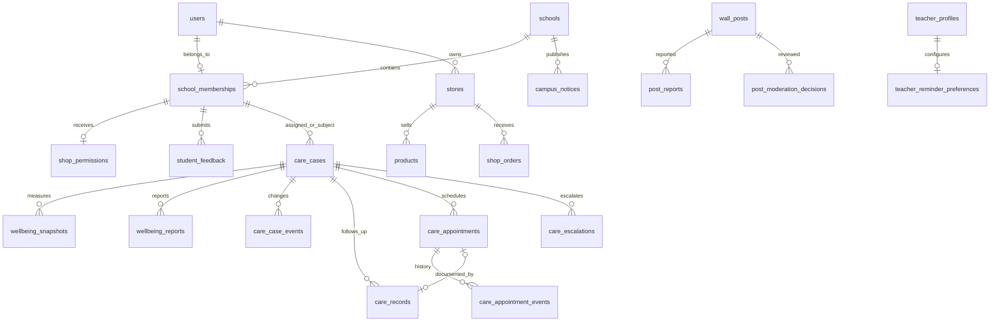

# 管理员、教师端数据库对接说明

本次对照仓库 `Cora-w/campus-companion` 的 `be31998bb073477e22455a6a86b808bf37382e52`（2026-10-12）。参考 `Frontend/docs/BACKEND_HANDOFF.md`、`src/types/domain.ts`、`features/admin`、`features/teacher`、`features/commerce` 和学校绑定逻辑。这里只提供 PostgreSQL 模型、权限和事务函数，前端、后端文件未修改，也未实现 HTTP 接口。页面中的本地模拟数据不会因为执行迁移自动进入数据库。

## 文件与迁移

| 文件 | 功能 |
| --- | --- |
| `db/migrations/011_staff_foundation.sql` | 学校、用户学校归属、账号管理、学校审计、意见反馈、通知权限 |
| `db/migrations/012_teacher_workflows.sql` | 加密关怀资料、复核/观察/记录/结案、预约及历史、升级确认、提醒偏好 |
| `db/migrations/013_campus_governance.sql` | 店铺经营授权、经营与管理停用独立状态、举报、审核证据、旧入口收紧 |
| `db/design/campus-platform.full.sql` | 001–013 的完整空库 DDL，已有库不要直接执行 |
| `tests/staff-workflows.mjs` | 新增业务状态、越权、幂等、并发预约测试，由原设计测试调用 |
| `tests/campus-design.test.mjs` | 创建临时数据库运行完整 DDL，验证原有及新增权限，结束删除临时测试库 |
| `README.md`、本文 | 安装入口、字段与函数映射、权限说明和待接入事项 |

新增 11 张表，业务表总数 77。旧迁移 001–010 原样保留，现有业务数据不删除。

## 关系图



`school_memberships.user_id` 为主键：一个用户属于一个学校。学生本人调用绑定函数，绑定后不可自行切换；教师、管理员由可信管理流程分配。学生拥有经营权限也仍是 student，不新增 merchant 角色。学生经营店铺有条件唯一索引，最多一间，撤权不删除店铺及订单。

## 管理员与学生校园功能

| 页面功能 | 数据结构与调用 | 对接要求 |
| --- | --- | --- |
| 学校列表、绑定 | `schools`、`school_memberships`；`bind_my_school(school_id)` | 学校主键沿用 `sichuan-aerospace-polytechnic`；显示名不可作为关联键 |
| 账号列表 | `admin_accounts` 视图 | 仅返回同校账号必要信息；`display_name` 映射 name，`login_account` 映射 account |
| 创建账号 | `admin_create_account(id,account,name,role,password_hash,email_ciphertext,email_lookup)` | 先生成 UUID，再按该 UUID 加密邮箱；密码由可信服务哈希；学校取管理员会话；不会伪造实名核验或自动生成教师/学生身份资料 |
| 修改/停用账号 | `admin_update_account(id,version,name,role,status)` | 禁止自降权/自停用与移除最后管理员；角色/状态变化删除该用户会话；返回新 version |
| 店铺授权 | `shop_permissions`；`admin_shop_permission(user_id,enabled)` | 仅同校活跃学生可获授权；撤销即时阻止经营、新订单；历史记录保留 |
| 店铺停用 | `admin_suspend_shop(id,version,suspended)` | `admin_suspended` 独立于店主的 `is_open`；店主不能解除管理停用 |
| 店主编辑 | `save_student_shop(id或NULL,version或NULL,name,location,hours,tagline,is_open)` | 校验本人、学校、实名和授权；停用期间保存资料不会更改营业开关 |
| 商品 | `products` 的 category/unit/icon/color 与既有 price_cents/stock_quantity/status | price 为整数分；`status='on_sale'` 映射 active；不能更换所属店铺；普通学生不能替他人编辑 |
| 校园通知 | `campus_notices`、`public_campus_notices` | title 1–60、detail 1–2000；draft/published，撤回回到 draft；修改必须 version+1；学生只读同校有效已发布内容 |
| 意见反馈 | `student_feedback` | body 最多500字符，至少5个非首尾空白字符或带图片；images 为最多3个 HTTPS URL；学生只能创建/看自己的反馈 |
| 回复反馈 | 更新 status/reply/replied_by/version | 管理员同校；pending/processing/replied；回复最多1000字、replied 必须非空；已回复不能回退状态 |
| 举报帖子 | `report_public_post(post_id,reason)`；`post_reports` | 同校实名学生、已发布公开帖子、不能举报自己；同校同帖同举报人唯一 |
| 审核列表/理由 | `admin_post_queue`、`admin_post_report_reasons` | 不返回匿名作者/举报人 ID；3名未处理举报人以上 priority=true |
| 保留/删除帖子 | `moderate_public_post(id,version,request_key,keep或delete,reason)` | 理由1–300字；关闭未处理举报；保留公开内容证据；幂等；删除从公开帖子、评论视图隐藏 |
| 操作日志 | `audit_logs.school_id` | 管理员仅本校；新管理操作记录资源 ID 和动作，不记反馈正文、关怀内容或密码 |

通知和反馈 UPDATE 建议显式 `WHERE id=$1 AND version=$2`，并将 version 设置为 `$2+1`；影响0行时重新读取并返回冲突，不能当成功。反馈 request_key 用于去重，重复 INSERT 返回唯一约束错误，服务读取本人已有行返回结果。

密码哈希规则由认证服务实施；SQL 无法验证某个字符串确实来自安全哈希算法。账号归属创建后不能由网页自行切换。旧学生/教师已有身份档案或教务/关怀关系时，角色切换可能被身份一致性约束拒绝（23514），需要专门的身份迁移流程，不能为了改角色直接删历史档案。禁用和编辑显示名不受此限制。

## 教师工作空间

| 页面字段/动作 | 数据库存储或函数 |
| --- | --- |
| 授权学生、来源、摘要、信号、趋势 | `care_cases` 的 teacher_id/student_id/school_id、analysis_source/analyzed_at、summary_ciphertext/signals_ciphertext；趋势使用既有 `wellbeing_snapshots` |
| 风险级别、状态 | `risk_level` 保留既有枚举；following 对应跟进中、archived 对应已结案；对外中文显示由 API 映射 |
| 复核后跟进、复核后观察 | `teacher_case_action(...,'review_follow_up'或'review_observe',payload)`；观察需 nextDate |
| 写跟进记录 | `teacher_case_action(...,'record',payload)`；必须已复核，记录写入 `care_records`，清除观察计划；可关联本个案已完成预约且一预约一记录 |
| 结案/重开 | `teacher_case_action(...,'close'或'reopen',payload)`；结案需已有记录、无进行中预约、无未确认升级；重开保留历史 |
| 升级支持 | `teacher_case_action(...,'escalate',payload)`；`care_escalations` 保存接收教师真实 ID、角色称谓、原因/措施密文 |
| 接收方确认 | `acknowledge_care_escalation(id)`；只能同校实名的实际接收教师确认；不能由发送方模拟确认 |
| 预约/改约/重邀 | `save_care_appointment(case_id,id或NULL,version或NULL,request_key,starts_at,minutes,method,location_ciphertext)` |
| 学生接受/拒绝/请求改约 | `respond_care_appointment(id,version,response,requested_start,note_ciphertext)` |
| 完成/未到/取消预约 | `finish_care_appointment(id,version,status)`；completed 必须学生 accepted |
| 预约历史 | `care_appointment_events`；每个版本留存，重邀清空当前回应但旧回应仍在历史 |
| 提醒设置/待办 | `teacher_reminder_preferences` 的 priority_enabled/follow_up_enabled；`teacher_workbench` 提供观察和最新跟进日期 |

关怀的 actor、student、teacher 必须使用数据库 UUID，不能拿前端展示名称或模拟 ID 建立关系。读写关怀要求当前教师已实名、分配给该个案、同校、学生仍有效、授权已开始且未过期/撤回。管理员和 Agent 不能读取关怀个案、记录和报告。学生仅能看到自己的预约事务及回应历史，不能看到风险、内部备注、心理记录。接收升级的教师只获该升级条目，未自动获取完整个案。

`teacher_case_action(case_id,expected_version,request_key,operation,payload)` 的 payload：

- `note`：必需密文，reopen 可省略；review/close 为说明，record 为摘要，escalate 为升级原因。
- `plan`、`response`：跟进计划与学生回应密文；record 必须 plan。
- `nextDate`：YYYY-MM-DD；record、review_observe 必需，按上海日期不能早于今天。
- `method`：in_person/online/phone/follow_up；record 必需。
- `appointmentId`：record 可选。
- `recipientId`、`recipientLabel`、`measures`：escalate 的接收人、称谓、措施密文。当前接收对象限制为同校教师账号，其他部门须建立授权接收角色后扩展。

JSON 中密文字段用 Base64 传输**已经加密**的字节；Base64 不是加密。API 应使用认证加密（如项目 `scripts/protection.mjs` 的 AES-GCM 格式），将对象 ID/字段名作为 AAD，后端校验原文长度后加密。数据库保存 bytea，不下发密钥。教师提醒只是偏好与查询数据，定时调度、通知发送需要服务端另行实现。

预约以 timestamptz 存储，API 使用带时区 ISO 8601；按 Asia/Shanghai 校验不能跨当天24点，时长30/45/60分钟、开始晚于当前时间。同教师跨个案使用事务锁防止重叠；重邀重置回应。预约创建和重邀以及个案动作均支持 request_key 幂等：同键同参数返回已有结果，同键换参数拒绝。重试应复用同一密文字节和参数（重新随机加密会成为新参数）。学生回应及结束预约使用版本控制，重复旧版本提交返回冲突；客户端应重新读取状态。

## 数据库连接与权限边界

Web、APP 通过业务后端访问；不得把连接串/密钥放进 VITE 变量。可信后端使用 app_backend，Agent 使用 app_agent；迁移账号仅用于 DBA 运维。每个已认证请求在事务中设置由服务端会话解析出来的上下文，连接池请求后必须结束事务：

```sql
BEGIN;
SELECT set_config('app.user_id', $1, true),
       set_config('app.session_hash', $2, true);
-- $1 为登录会话所属 UUID，$2 为有效会话 token_hash 的十六进制。
-- 在同一连接/事务调用本文函数或授权视图，使用参数化 SQL。
COMMIT;
```

上下文不能直接信任 HTTP 中用户传来的 userId、role 或 schoolId。新增函数从有效会话重新核对身份/学校。app_backend 仍保留已有认证注册所需的 users/session 能力，属于可信服务账号，并非可供浏览器执行任意 SQL 的沙箱；管理页面只能通过本文限定函数/视图。任何管理员 HTTP 路由不得直接返回原始 users 表。Agent 没有新增私密表读取权限，也不能调用管理/关怀动作。

常用错误映射：42501 权限不足→403；40001 版本冲突→409；23505 重复→409（幂等键按具体接口读取已有结果）；23P01 预约冲突→409；23514 状态/参数不合法→422。不要把数据库原始错误详情回传客户端。

## 升级与归属核对

```powershell
npm.cmd run db:backup
npm.cmd run db:init
npm.cmd run check
```

迁移自动添加一个学校目录项，不自动将所有历史账号绑定该校。应由 DBA 用迁移账号核对真实归属后初始化首个管理员/教师；下面仅为参数化 SQL 模板，不要原样粘贴带 $1 的语句到普通查询窗口：

```sql
INSERT INTO app.school_memberships(user_id,school_id,assigned_by)
VALUES ($1, 'sichuan-aerospace-polytechnic', $2);
-- $1 为已核对账号的 UUID，$2 为分配管理员 UUID，首次引导可为 NULL。
```

后续由同校管理员创建账号会自动分配学校。学生用绑定函数。教师/学生档案和真人核验仍通过可信身份流程完成；新建账号不代表核验成功。新个案建立和授权登记由受控数据导入/授权服务负责，目前不开放教师自行给自己新增学生授权。

旧 care_cases.school_id 为 NULL，在核对学生和教师均归属同校后，由 DBA 按个案指定 school_id；未归属个案保持不可访问。旧通知在补齐 school_id 前不再进入学生通知视图。原食堂目录以及旧公开帖子保留 NULL school_id 的公开兼容行为；若要严格多校运营，必须核对后补齐这些历史数据。不得批量猜测归属。历史内容不通过新增管理功能审核，需先完成学校归属。

本次对新增管理员/教师模块与相关店铺、通知、反馈、帖子实施学校权限；并非宣称原有教务、支付、跑腿等所有旧模块已经完成全平台多租户改造。旧订单结算、商品库存/金额事务、上传 URL 的来源校验仍须后端业务实现。收藏/搜索列表应连接 `wall_public_posts`，不要使用缓存或收藏快照把已删除帖子的正文继续返回。

## 验证范围

设计测试在临时 PostgreSQL 数据库执行全部 DDL，并覆盖跨学校、未实名/过期/停用、匿名与私密数据、账号创建/修改、撤权、预约并发、幂等重试、反馈/通知状态、举报审核及旧教务/聊天权限。运行 `npm.cmd run check` 包含配置、连接/校验和、密码及数据库测试。

当前仓库只有认证与学校绑定等接口契约；管理员和教师业务仍使用前端模拟状态。完成本文模型不等于端到端业务已经上线；后端需逐个实现接口、对接实名服务、加解密、通知、缓存失效，再由前端切换对应业务数据源。
